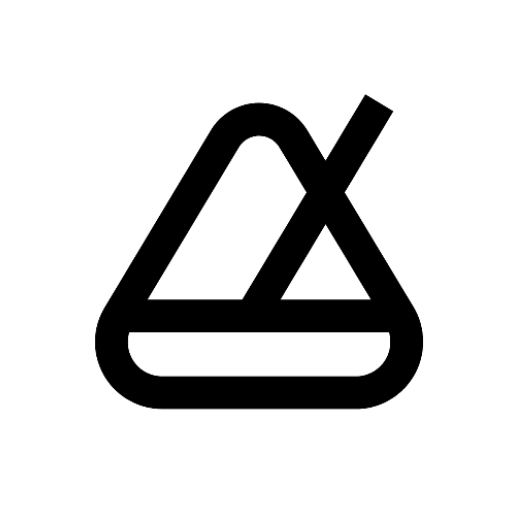

# Metronome

*Precise timing. Better practice.* A metronome for musicians, built with **Kotlin Multiplatform** and **Compose Multiplatform**. It runs on Android, iOS, macOS and in the browser at [metronome.merkost.dev](https://metronome.merkost.dev/app/).

Current version: **1.6.0**. See [CHANGELOG.md](CHANGELOG.md) for the history.

## Features

- **Tap tempo** and a BPM control with quick-adjust buttons
- **Time signatures, subdivisions and click sounds**, with a preview before you choose
- **Practice tools**: timer with countdown, tempo trainer (step by bars, gap cycles or tap), gap trainer, phrase marker
- **Practice presets and practice sets** to keep the setups you return to
- **Background playback**: the click keeps going with the screen locked, with lock-screen controls on Android and a Live Activity on iOS
- **Ten languages**: Spanish, French, German, Brazilian Portuguese, Italian, Japanese, Korean, Simplified Chinese, Russian and Turkish
- **Colour schemes** including dynamic Material You, a designed dark theme and support for reduced motion
- **On the Mac**: sidebar navigation, keyboard shortcuts and a merged title bar

## Tech stack

| Layer | Tech |
|-------|------|
| Shared UI | Compose Multiplatform |
| Business logic | Kotlin Multiplatform (`commonMain`) |
| DI | Koin |
| Persistence | DataStore Preferences |
| Audio | SoundPool (Android), AVAudioEngine (iOS), desktop and web audio engines |

## Project structure

```
shared/                 -- KMP library (shared UI, models, engine)
  src/commonMain/       -- Shared code and composeResources (strings, plurals)
  src/androidMain/      -- Android platform implementations
  src/iosMain/          -- iOS platform implementations
  src/desktopMain/      -- macOS desktop implementations
  src/wasmJsMain/       -- Web implementations
androidApp/             -- Android application shell
iosApp/                 -- Xcode project (app and widgets)
desktopApp/             -- macOS packaging
docs/                   -- The published website (Cloudflare Pages)
project-docs/           -- Internal documentation, start at project-docs/README.md
tools/                  -- Release verification, translation checks, screenshot capture
```

## Build

```bash
# Android
./gradlew :androidApp:assembleDebug

# iOS framework (simulator), then open iosApp/Metronome.xcodeproj in Xcode
./gradlew :shared:linkDebugFrameworkIosSimulatorArm64

# Desktop
./gradlew :desktopApp:run

# Web
./gradlew :shared:wasmJsBrowserDevelopmentRun
```

## Tests

```bash
./gradlew :shared:testDebugUnitTest
python3 tools/check-translations.py
```

## Documentation

- [project-docs/](project-docs/README.md): roadmap, store strategy, design research, engineering audits and release records
- [PRODUCT.md](PRODUCT.md) and [DESIGN.md](DESIGN.md): product and design briefs
- [CLAUDE.md](CLAUDE.md): engineering rules
