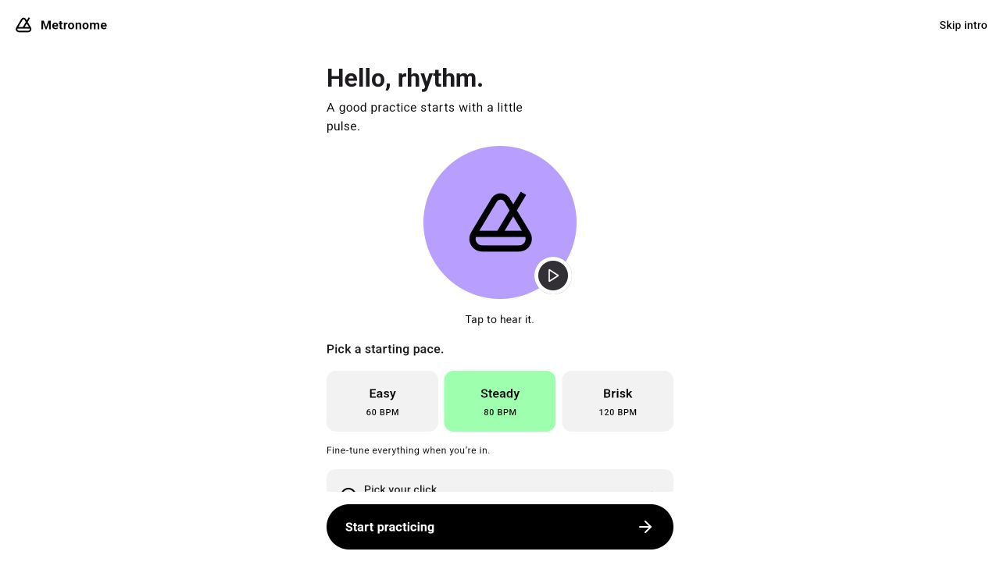
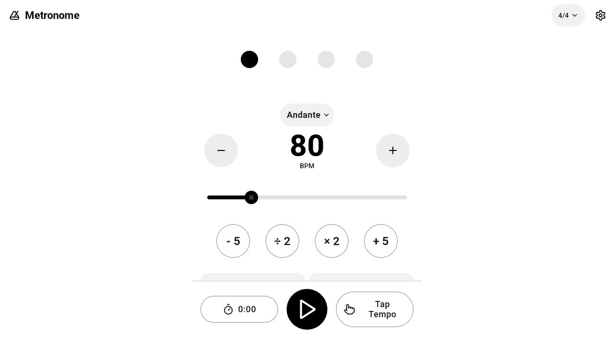
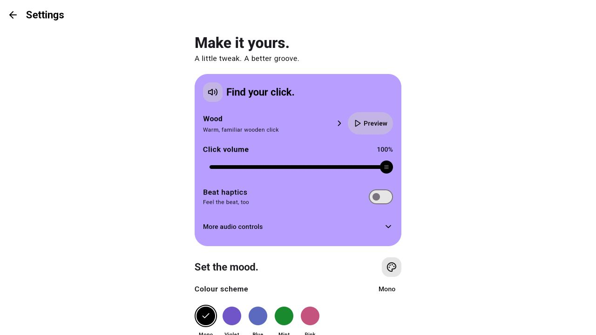
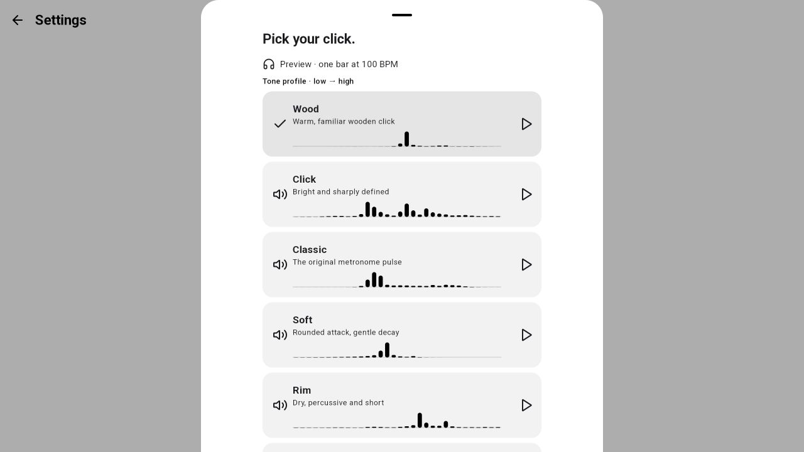
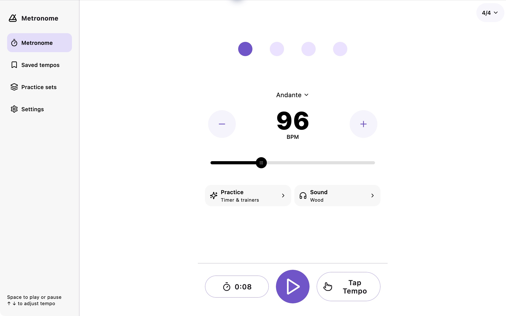
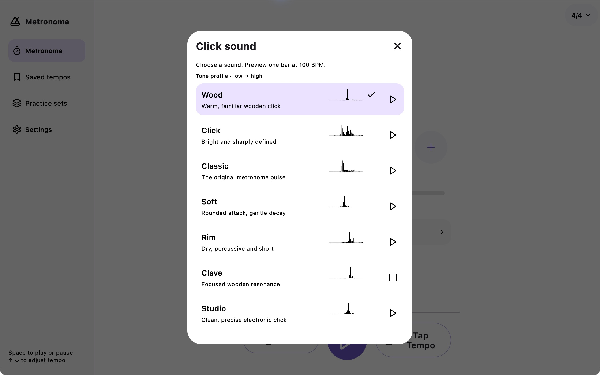
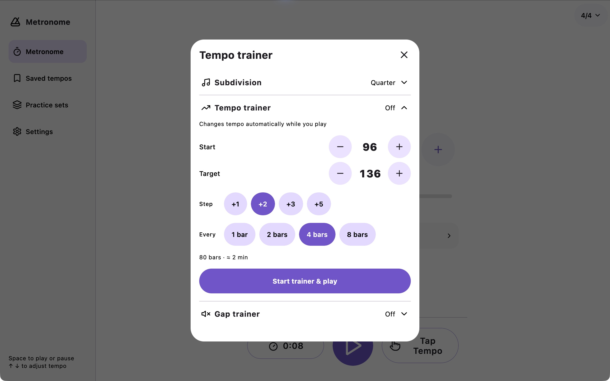
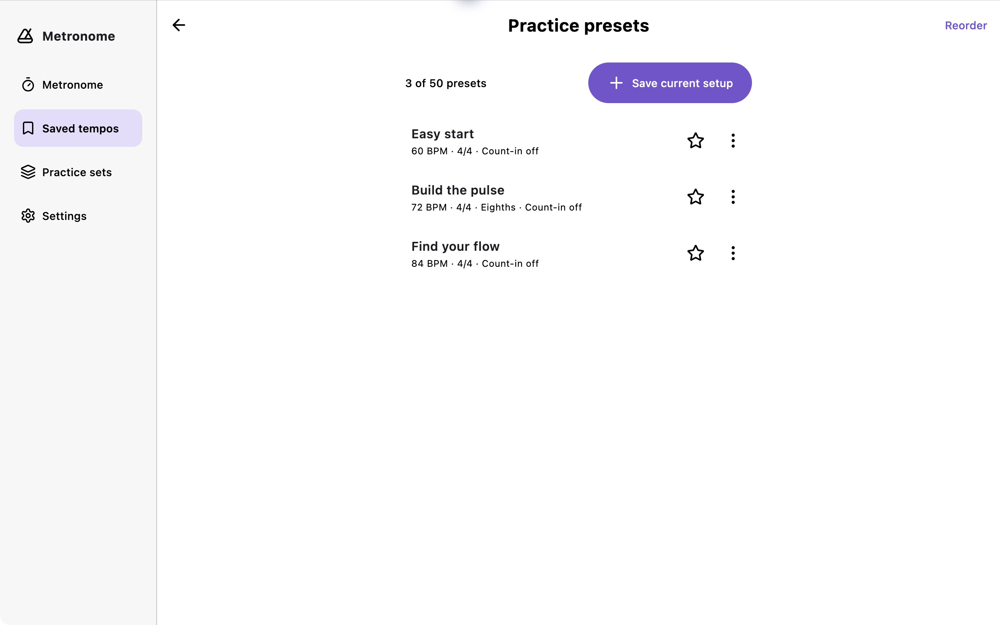
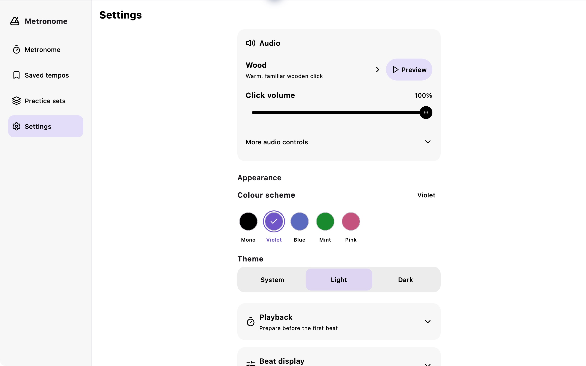

# Desktop review — 22 October 2026

Fresh baseline captures use the public web app at `https://metronome.merkost.dev/app/`, at 1280×720. Its Settings footer reports 1.4.0. These are evidence of the deployed web interface, not proof of the current native 1.5.0 working tree or the future Mac application. The Mac implementation uses the current native source and its simpler welcome.

1. **Welcome — needs desktop adaptation.** The logo and concise headings communicate the brand. The narrow central setup column and fixed bottom action crowd the sound choice at this height. The 1.5.0 source already replaces this older setup flow with one illustrated introduction; retain that simpler flow on Mac.

2. **Instrument — needs window-aware navigation and height testing.** BPM, dots and playback are clear. At 720px tall, Practice and Sound are largely hidden behind the fixed playback region. The wide window provides no persistent navigation and leaves the phone-width center isolated. Use the current native source's cleaner tempo controls, add desktop navigation, and test constrained window heights explicitly.

3. **Settings — preserve clear controls, remove unsupported options.** Appearance choices and preview are easy to identify, but haptics are visible on this desktop surface. Mac should expose useful desktop capabilities and omit phone-only options. Keep the current native source's literal groups and theme-aware styling.

4. **Sound picker — healthy content, mobile presentation.** Separate selection and preview controls and tone profiles help identify sounds. A bottom sheet that reaches the window's upper edge feels oversized on desktop and hides later sounds below the viewport. Reuse the content in a centered dialog with bounded scrolling and an explicit close control.

## Accessibility and evidence limits

Visible labels and semantic beat descriptions are present in the baseline. Desktop focus order, keyboard access, text scaling, VoiceOver, reduced motion, packaged audio timing and sandbox file access require testing in the actual Mac application. These web screenshots alone establish none of those acceptance claims. Subsequent native Mac observations and verification are recorded separately below.

## Native Mac acceptance — final signed 1.5.0 image

The checks below use the packaged native Mac application, separate from the public web 1.4.0 baseline above. The final signed image provides persistent desktop navigation, centered tool dialogs, native menus and file pickers, and the current shared 1.5.0 UI. Phone-only controls are omitted from the Mac presentation.

Fresh-install, populated-import and relaunch checks use the frozen `Metronome Welcome Acceptance Final.app` copy, signed by the same team with identical production JARs and resources and a unique sandbox. This isolates acceptance data from the main app. That copy is a test artifact, not the submitted production package.

### Observed native interactions

| Area | Observed result |
| --- | --- |
| Instrument | Space starts and pauses playback. The outlined active beat advances; the filled beat retains its accent meaning. The elapsed counter reached 0:08. Exact tempo entry set the instrument to 96 BPM. |
| Navigation | Cmd+1, Cmd+2, Cmd+3 and Cmd+Comma open their intended destinations. |
| Appearance | Light and dark appearance and color-scheme changes were exercised in the native app. |
| Sound | The picker presents all seven tones and supports preview. The captured Clave row shows an active preview. |
| Dialog dismissal | Escape dismisses newly opened Sound, Rhythm, exact-tempo and About dialogs. Escape also dismisses Practice data after returning from native Export and Import. |
| Unsaved practice sets | Cmd+Comma and Cmd+Q prompt before leaving a dirty editor. Cancel preserves the entered text. |
| Starter content | Adding the starter content created three saved tempos and one practice set. |
| Backup export | The native Save panel exported a populated backup. Overwriting the selected backup also completed successfully. |
| Fresh welcome | The isolated acceptance copy showed the single-screen welcome at 1000×780 and 520×600. Cmd+Comma kept the welcome visible; Get started opened the instrument. |
| Populated backup import | The native Open panel imported the populated backup and reported three added presets and one added set. Cmd+2 showed the exact three imported names; Cmd+3 showed “A steady warm-up” with three steps. |
| Relaunch persistence | After selecting Mint and Dark, Cmd+Q followed by relaunch retained the three presets, one practice set, Mint color scheme and Dark appearance. Welcome did not reappear. |
| Window layout | The final production image was reviewed in a 1280×828 window. The final acceptance copy's welcome was also checked at 520×600. The compact instrument interaction pass used an earlier packaged image with the same layout; it was not repeated on the final production image. |

### Fresh-install and persistence captures

- [Fresh welcome at 1000×780](native/07-fresh-welcome-qa.jpg) and [compact welcome at 520×600](native/08-compact-welcome-qa.jpg) show the isolated acceptance copy. Captures use the display's 2× pixel scale.
- [Import interaction](native/09-import-backup-qa.jpg) records the visible import viewport. The success confirmation was below the captured viewport and was verified through the native accessibility tree; the screenshot alone does not show that confirmation.
- [Restored settings after relaunch](native/10-restored-settings-qa.jpg) records retained Mint and Dark appearance.

### Automated and artifact evidence

- [Desktop test receipt](tests/desktop-tests.json): 245 shared common and desktop tests passed, with zero failures, errors or skipped tests. Coverage includes desktop keyboard and dialog behavior, unsaved-editor navigation guards, delayed audio preparation, stop/release behavior and application-exit persistence.
- [Packaged audio smoke receipt](tests/audio-hardware-final.json): all 14 LOW/HIGH submissions across seven sounds reached the current default audio output. Mute and playback suppression after release passed. This exercised packaged production classes and resources through the configured JBR; it establishes PCM acceptance, not speaker audibility or measured onset timing, and is separate from signed-app sandbox acceptance.
- [Organizer delivery package verification](tests/organizer-export-package-verification.json) and [export provenance](tests/organizer-export-provenance.json): the exported package retains all 79 JARs and executable content, entitlements and signing flags for all 30 native binaries. Only renewed signatures and semantically identical runtime Info.plist formatting changed.
- [Xcode archive verification](tests/xcode-archive-app-verification.json) and [independent archive provenance](tests/xcode-archive-provenance.json): all 79 JARs, nested native binaries, resources and symlinks match the tested app; Xcode adds archive metadata and replaces the outer signature. The original signed PKG remains unchanged.
- [Signed app verification](tests/signed-app-verification.json) and [signed package verification](tests/signed-package-verification.json) record static artifact validation separately from native UI checks and store delivery.
- [Store screenshot manifest](store/screenshots/manifest.json): five actual native captures exported as 2560×1600 opaque RGB PNGs. Only the 56-pixel window title bar was cropped. Pixel comparisons and source/export SHA-256 hashes are recorded; original captures remain in `native/`. All five exports were visually inspected. The Settings capture is a scrollable viewport with further sections below its bottom edge.

### Store preparation and remaining boundaries

The Mac listing has its description, promotional text, review notes, working URLs and all five screenshots saved. The genuine Xcode archive was uploaded through Organizer using the existing Xcode account, with no separate Transporter app. Apple processed version 1.5.0 build 1, and the build was selected and submitted for review on 22 October 2026 at 22:17 AEDT.

App Store Connect confirms **Waiting for Review**, submission `d8f0ecac-ab77-4fae-b2df-80b49ddde8f1`, with automatic release after approval selected. See the [submission receipt](store/mac-waiting-for-review.jpg), [listing status](store/listing-status.json), and [Organizer upload result](store/xcode-upload-status.json). Public Mac availability is pending Apple's approval.

Organizer completed delivery with non-blocking warnings: the profileless production build is not eligible for TestFlight, and the prebuilt launcher, Skiko and Java runtime did not include matching dSYM files. This limits native crash symbolication. The complete warning text is retained in `store/xcode-upload-completed.txt`; exported distribution details and the signed uploaded PKG are preserved in `store/Metronome-Mac-1.5.0-1-upload/`.

VoiceOver, measured speaker latency, output-route changes and sleep/wake audio recovery have not been verified. Automated large-text and keyboard checks do not substitute for a VoiceOver pass. Native acceptance, static package validation, build delivery, review submission and public availability remain distinct evidence stages.
