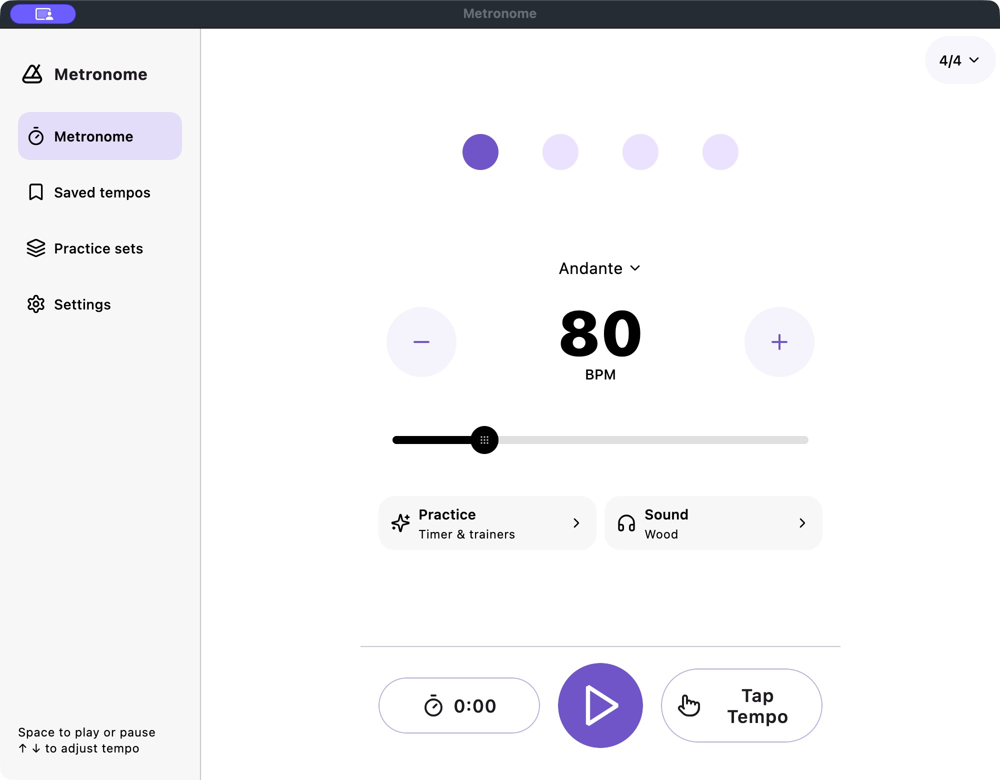
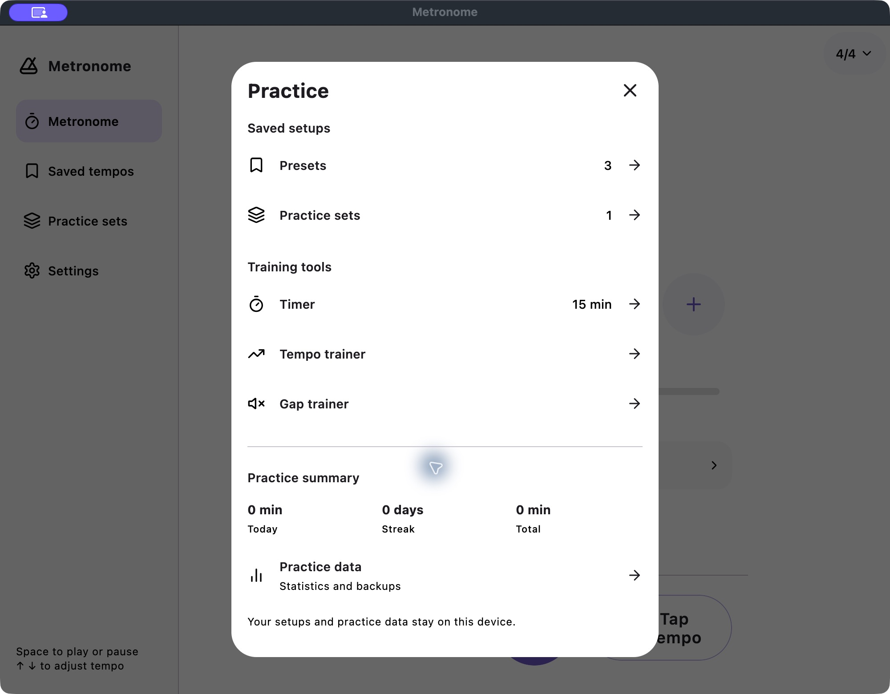
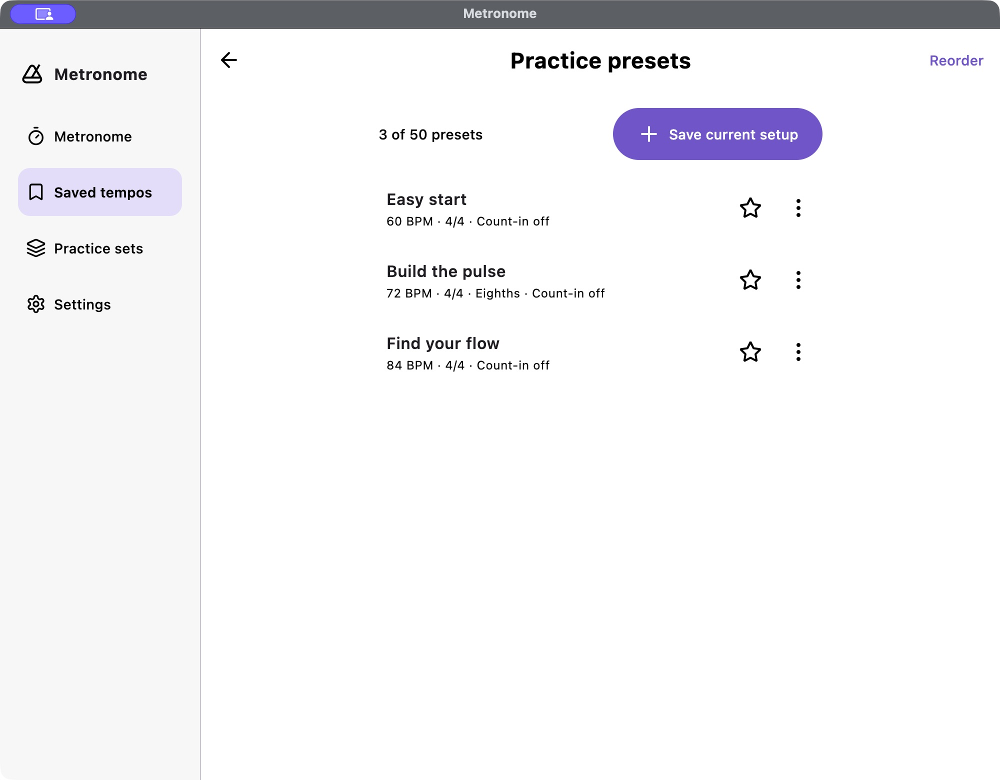
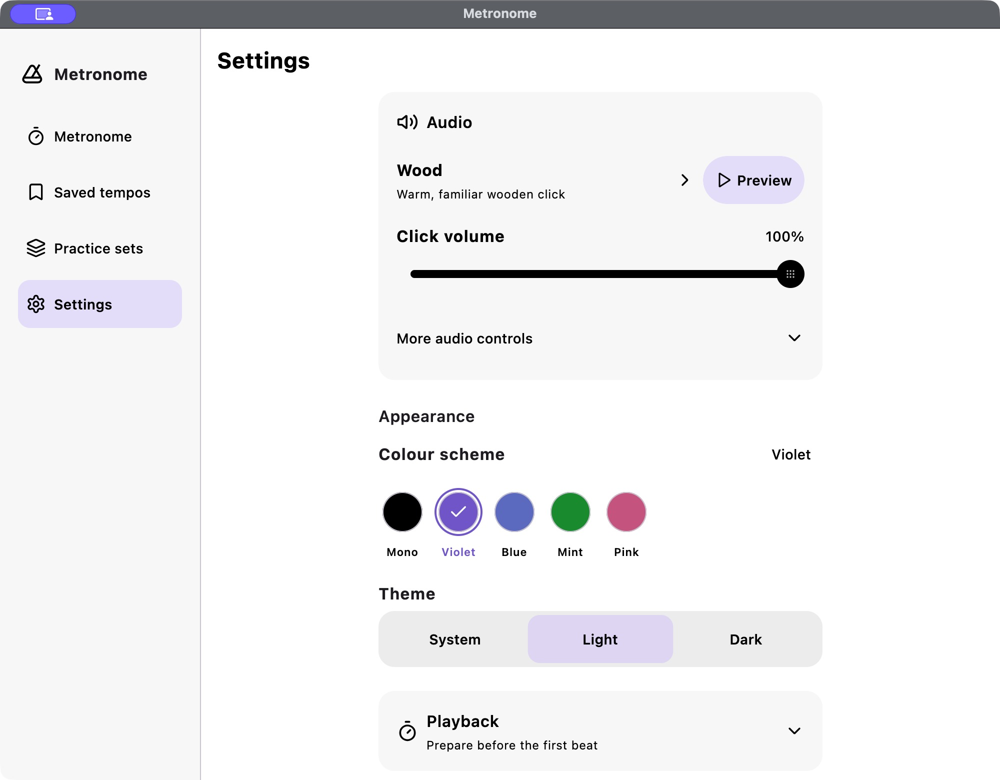

# Metronome UI/UX review — 22 October 2026

The current app is clear and usable at the captured Mac window size. Its strongest elements are the dominant BPM, unnumbered beat dots, recognizable brand mark, direct playback control and restrained violet selection. The opportunity is to reduce searching and give related controls a clearer home, while retaining this instrument-like simplicity.

## Evidence and scope

This review uses four fresh captures of the signed native Mac 1.5.0 app, taken during this review at a 1000×780-point window size (2000×1560 pixels). Each saved image was opened and inspected. Source inspection supports the naming and navigation observations. These are expert-review hypotheses, not measured user research or evidence of task-completion rates.

| Step | Surface | General health |
| --- | --- | --- |
| 1 | Instrument | Clear core task; related controls are spread apart |
| 2 | Practice | Readable, but mixes tools, library navigation and statistics |
| 3 | Saved tempos | Clear small list; naming and hierarchy can improve |
| 4 | Settings | Legible groups; first viewport is dominated by audio and appearance |

## 1. Instrument

**Observed:** BPM is the strongest value and Play is easy to identify. Practice and Sound have matching heights. The logo and selected destination establish location. No essential control is visibly clipped in this capture. The 4/4 control sits at the far upper right, separated from the centered beat row; there are substantial vertical gaps between beats, tempo and playback.

**Improve:** Keep a bounded instrument composition rather than filling unused space with statistics. Bring a concise Rhythm summary nearer the beat controls, showing meter and subdivision together. Keep the Play position stable and the BPM dominant. Offer Focus as an explicit optional mode for people placing Metronome beside sheet music; do not make its reduced controls the default.

**Preserve:** An outer ring means the currently sounding beat; a solid dot means accent. Do not add numbers to the dots. Only changed BPM digits should roll, and rapid input should interrupt existing motion.

**Hypothesis to validate:** Grouping beat setup with beat feedback will make rhythm editing easier to discover. The screenshot cannot establish whether users currently miss it.

## 2. Practice

**Observed:** The modal has a clear title and close action, good grouping, and readable tool names. Saved setups appears first, duplicating Saved tempos and Practice sets already visible in the sidebar. The three training tools come next, followed by summary and backups. The result is a general navigation menu rather than a clear starting point for a practice task.

**Improve:** Make Practice a persistent task destination on desktop. Lead with actionable tools: practice for a duration, build tempo, or train through quiet bars. Give each one a single short explanation and its current configuration. A recent routine may be a quiet continuation action; statistics should remain secondary. Let Library own saved tempos and practice sets. Retain direct access from the instrument.

**Feature distinction:** Timer, tempo trainer, fixed gap trainer, routines and local totals already exist. Repeatable tempo rounds and a Hold control are new proposals, not existing capabilities.

**Hypothesis to validate:** Removing duplicate library navigation will reduce choices before starting a trainer. Avoid adding a dashboard of achievement cards or streak pressure.

## 3. Saved tempos / Library

**Observed:** The sidebar says “Saved tempos,” the page says “Practice presets,” and the Practice dialog says “Presets.” All refer to the same collection. The visible list is easy to scan with only three items. “3 of 50 presets” has considerable emphasis, while “Save current setup” is the dominant action. Each row repeats “Count-in off.” A back arrow is visible in addition to persistent desktop navigation.

**Improve:** Use one vocabulary throughout: Library, with Saved tempos and Practice sets as clear tabs. Keep named rows compact and show BPM, meter and meaningful rhythm differences. Reserve capacity warnings for when the limit approaches. Add search and an optional Favorites filter as the library grows. When saving, preview the current setup and ask for a name. Reduce redundant “off” metadata; preserve full details in editing. On desktop, use back only for an actual nested task.

**Preserve:** Applying a saved setup, favoriting, editing and starting a set are distinct actions. Do not start playback unexpectedly when someone selects a saved tempo.

**Hypothesis to validate:** Search and filtering become useful with a larger collection; the three-item capture alone does not demonstrate a search problem.

## 4. Settings

**Observed:** Audio and Appearance are labeled literally, the selected color has a checkmark and text label, and the palette is left aligned. System/Light/Dark are equal-sized choices. The audio panel uses much of the initial viewport. At this size, the bottom reaches only the beginning of Playback, leaving later categories below the fold.

**Improve:** Tighten the audio section without reducing control targets: one selected-sound row, a fixed-width preview action, volume, then a concise advanced disclosure. Keep Appearance, Playback, Beat display, Practice data and Help as consistently spaced groups. Keep secondary settings behind reversible disclosures and show useful summaries while closed. Retain compact permanent web-app access and More by Merkost near the end; do not add promotion to the instrument.

**Preserve:** Appearance controls must not change size on selection. Preview/Stop must occupy the same bounds. Theme changes need readable intermediate colors; disclosure content and switches must enter and leave together. These are implementation acceptance criteria, not verified animation results from a still image.

## Priorities for the web proposal

1. **Now:** consistent navigation and library naming; clearer Practice entry; compact settings hierarchy; rhythm setup near the beats.
2. **Next:** optional Focus player and tempo-training Hold/rounds, with explicit states and a direct way back to the full instrument.
3. **Explore:** swing feel with an exact ratio, clear Straight reset and a subdivision preview. Progressive quiet-bar training can follow after its interaction and audio behavior are validated.

The one-screen welcome should remain a short graphic introduction with three concise benefits and one Get started action. It must enter silently without changing a musician's existing setup. No fresh welcome screenshot was captured in this four-screen audit; that recommendation follows the current `DESIGN.md` and existing welcome implementation, not new runtime evidence.

## Accessibility and validation limits

The captures support visual hierarchy, wording, grouping and visible selected-state observations. They do not establish VoiceOver order, keyboard focus behavior, exact target dimensions, contrast compliance, large-text reflow, motion quality, audio timing or compact-window acceptance. The prototype should expose keyboard-operable controls, visible focus, named values, non-color selection cues and reduced-motion behavior. Native versions still require device testing. Proposed audio features need scheduler, interruption and physical-output validation before release claims.

## Source anchors

- `DESIGN.md`: instrument hierarchy, single-screen welcome, 48dp targets, bounded content and shared motion.
- `shared/src/commonMain/kotlin/com/merkost/metronome/ui/DesktopAppShell.kt`: desktop navigation labels and responsive sidebar.
- `shared/src/commonMain/kotlin/com/merkost/metronome/screens/PracticeHubSheet.kt`: saved setups, tools and statistics order.
- `shared/src/commonMain/kotlin/com/merkost/metronome/screens/PracticePresetsScreen.kt`: library title, capacity summary and save-current action.
- `shared/src/commonMain/kotlin/com/merkost/metronome/screens/SettingsScreen.kt`: settings groups, sound preview and web entry.
